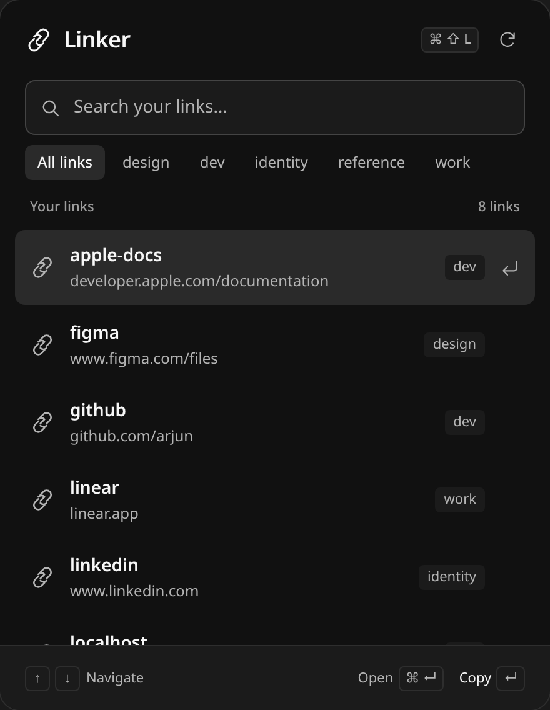
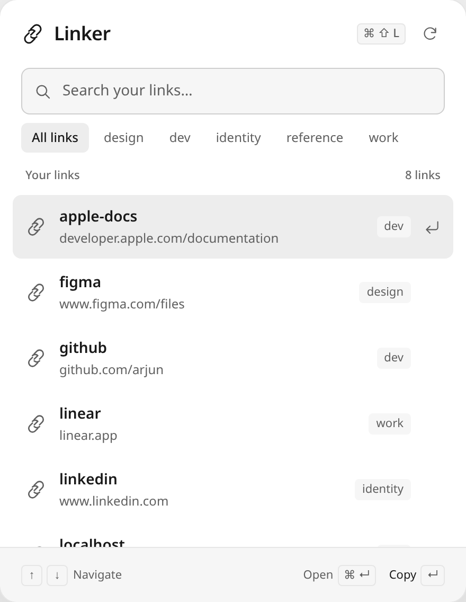

# Linker for macOS

A small menu bar app for the links you reach for every day. Click the link icon or
press **⌘⇧L**, find an alias, and press Return to copy its URL. The panel has a
readable two-line list, tag filters, and light and dark appearances that follow
your Mac’s settings.

It reads the **same store as the CLI**: `~/.config/linker/links.json`, or the path
in `LINKER_STORE` when that environment variable is passed to the app. Editing
stays in the terminal. The app does not change links or copy statistics.

## See it without a Mac

From the project root:

```sh
python3 macos/preview.py --open
```

Open **http://127.0.0.1:4178**. Use `--port 4180` if that port is occupied. The
preview needs Python 3 and a modern browser, with no dependencies to install.
Stop the server with Ctrl+C.

The browser preview mirrors the native panel’s 440 × 568 pt layout, palette,
labels and fuzzy ranking. On narrow browser windows it fits the available width.
Use the sun/moon controls to compare appearances and the state selector to see an
empty library, an unsuccessful search or a file error. Search, tag filtering,
arrow navigation, clipboard copying and opening URLs all work. On Linux/Windows,
Ctrl can substitute for Command within the page; some browser shortcuts may take
precedence. Clipboard access requires the localhost URL and browser permission.

**Load links.json** accepts a CLI export or store file. It reads the chosen file
inside your browser, without uploading it or changing it. The reload button uses
that snapshot; load the file again to see later edits. **Reset preview** restores
the eight sample links in [`preview/sample-links.json`](preview/sample-links.json):
apple-docs, figma, github, linear, linkedin, localhost, notion and swift. These are
demonstration data, including the GitHub alias from the CLI README.

These screenshots come from the browser preview. Native system typography,
menu bar placement, the global hotkey, login registration and pasteboard behavior
still require a Mac to verify. The native application cannot be built or run on
Linux or Windows.

| Dark appearance | Light appearance |
| --- | --- |
|  |  |

## Build and install the native app

Requirements: macOS 13 (Ventura) or newer and Xcode Command Line Tools
(`xcode-select --install`). Python 3 is used by the companion CLI.

```sh
# From the project root:
./macos/build.sh                 # → macos/build/Linker.app
./macos/build.sh --install       # → /Applications/Linker.app, then launches it
```

The build compiles `LinkerApp.swift` (store, actions, AppKit lifecycle and hotkey)
and `LinkerViews.swift` (SwiftUI presentation) and targets macOS 13 explicitly.

After launching, right-click the menu bar icon for **Launch at Login**, **Open
links.json**, and **Quit Linker**. Launch at Login requires the app to live in
`/Applications`.

## Controls

| Input | Action |
| --- | --- |
| Menu bar icon or **⌘⇧L** | Show/hide the panel |
| Type | Fuzzy search alias, URL, tags and notes |
| Tag button | Combine a tag filter with the current search |
| ↑ / ↓ or hover | Select a link; keyboard selection scrolls into view |
| Return, click a row, or Copy | Copy the selected URL, confirm, then hide |
| **⌘Return** or Open | Open the selected link in your browser |
| **⌘R** or reload icon | Reread the store |
| **⌘F** | Focus search |
| Escape / click outside | Hide the panel |

An unreadable store shows a retry action. A missing store shows the command to
save your first link. A search with no results offers **Clear filters**. Copy
failures keep the panel open so you can retry.

## Validation

```sh
python3 -m unittest discover -s tests   # CLI regressions
node --test tests/test_preview.mjs     # preview ranking / schema checks (optional Node 18+)
```

The preview was checked in local Chrome at 1440, 768 and 390 px in both
appearances, including local JSON import, clipboard success/denial, keyboard
scrolling, opening links, and empty/error recovery. Swift sources were parsed
for syntax on Linux. **The native build has not been compiled or executed on a
Mac.**

Presentation uses the system font, simple outline symbols and neutral surfaces.
Implementation references: Apple’s [ScrollViewReader documentation](https://developer.apple.com/documentation/swiftui/scrollviewreader)
and [pasteboard API](https://developer.apple.com/documentation/appkit/nspasteboard/setstring(_:fortype:)).

## Troubleshooting

- **Build errors:** keep the `swiftc` output for diagnosis. Syntax checks on Linux
  do not verify macOS types or SDK availability.
- **Hotkey does nothing:** another app may have claimed ⌘⇧L. Change
  `registerHotKey()` in `LinkerApp.swift` and rebuild.
- **A different store:** a Finder-launched app does not inherit a terminal’s
  environment. Run its executable with `LINKER_STORE` set to use an alternate path.
- **Panel placement:** the panel uses the status icon’s screen and clamps its
  origin to that display’s visible area.
- **Uninstall:** quit Linker, then remove `/Applications/Linker.app`.
